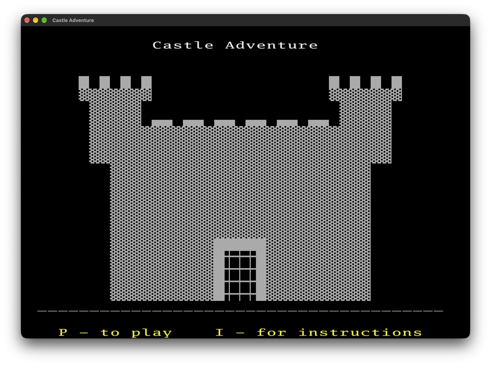
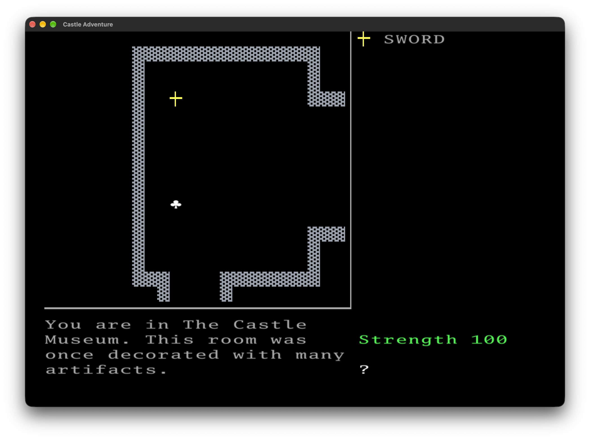
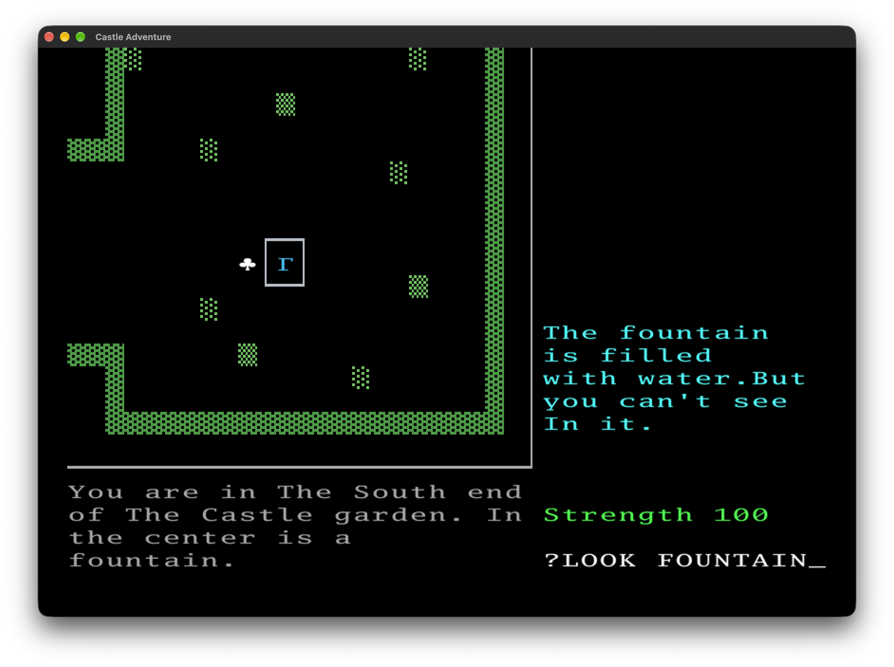

# Castle Adventure (1984)

Kevin Bales's 1984 DOS freeware game *Castle Adventure*, taken apart and rebuilt.

**[Play it in your browser](https://sirgwain.github.io/castle-adventure/)**

- **A playable Go port**, built with [Ebitengine](https://ebitengine.org/), for the desktop and the browser. It keeps the original 40-column text screen and IBM PC characters, and adds colour.
- **[The recovered BASIC source](out/castle.bas).** The original was compiled with IBM BASIC Compiler 1.0. The compiled code was lifted back into structured, commented BASIC.
- **[An annotated disassembly](out/castle.asm)** of the compiled program.
- **[A map atlas](https://sirgwain.github.io/castle-adventure/atlas.html)** of all 83 rooms, laid out floor by floor with their stairs. There is also a [plain-text version](out/atlas.txt).
- **[Notes on the game's mechanics](out/MECHANICS.md)**, including bugs in the original.
- **Editable levels.** Every room is in a JSON file that you can change without touching code.

<p align="center">
  
  
  
</p>

## Playing

The easiest way is [in your browser](https://sirgwain.github.io/castle-adventure/). To run it on your own
machine you need [Go](https://go.dev/dl/) 1.27 or later.

```sh
go run .
```

You are trapped in a deserted castle that is full of treasures. Find the 13 treasures and escape. Use the
arrow keys or numeric keypad to move, and run into a visible item to pick it up. Type two-word commands
such as `LOOK DESK`, `GET KEY` or `OPEN DOOR`. Look at everything carefully.

| Key | Action |
|---|---|
| Arrows / numeric keypad | Move |
| Enter | Run the typed command |
| Esc | Clear the command |
| Tab | Switch between colour and the original grey-on-black |
| F2 | Mute the sound |
| F11 or Alt+Enter | Full screen |

`SAVE name` and `LOAD name` save and load games. Saves and the high score are kept in your user config
directory, under `castle-adventure`. In the browser they are kept in the browser's local storage for the site.

Options:

```sh
go run . -classic                 # start in the original grey-on-black
go run . -room 67                 # start in room 67
go run . -levels internal/castle/levels   # play level files from disk, without rebuilding
go run . -room 67 -screenshot room.png    # write a PNG of a room and exit
```

### Building the browser version

The browser version is the same program compiled to WebAssembly. GitHub Actions builds it and publishes
it to GitHub Pages on every push to `main` (see [`.github/workflows/pages.yml`](.github/workflows/pages.yml)).
To build and serve it locally:

```sh
mkdir -p site
GOOS=js GOARCH=wasm go build -o site/castle.wasm .
cp "$(go env GOROOT)/lib/wasm/wasm_exec.js" web/index.html out/atlas.html site/
python3 -m http.server -d site 8000      # then open http://localhost:8000
```

## The original game

`Castle.1984/` contains the original, unmodified release. It includes `CASTLE.EXE`, its room data file
`CASTLE.RAN`, and the author's notes. It runs in [DOSBox](https://www.dosbox.com/) or on any IBM PC
compatible.

The game has no timer. Monsters move every 200 passes through the input loop, so on a modern machine they
are far too fast. For the 1984 speed in DOSBox, emulate a CGA machine at about 300 cycles. See
[`out/MECHANICS.md`](out/MECHANICS.md) for the measurement.

## What's in the repository

| Path | Contents |
|---|---|
| `main.go`, `app.go`, `screens.go`, … | The port: windowing, input and screens |
| `store.go`, `storage_*.go` | Saved games and the high score: files on the desktop, local storage in the browser |
| `web/index.html` | The page that loads the browser version |
| `internal/game` | Game rules: movement, commands, monsters, scoring |
| `internal/castle` | Loading the levels, and the room renderer |
| `internal/castle/levels` | The level files, one per floor. See the [README there](internal/castle/levels/README.md) for the format. |
| `internal/textmode` | An IBM PC 40/80-column text screen and CP437 font |
| `internal/speaker` | PC speaker sound |
| `out/castle.bas` | The recovered BASIC source, structured and commented |
| `out/castle_flat.bas` | The same code as a flat, line-by-line listing |
| `out/castle.asm` | Disassembly of the compiled user code |
| `out/MECHANICS.md` | How the game works, and the bugs in the original |
| `out/atlas.html`, `atlas.txt` | Maps of every floor ([online](https://sirgwain.github.io/castle-adventure/atlas.html)) |
| `out/rooms.json`, `objects_monsters.json`, `atlas.json` | The room, object, monster and map data, exported from the original files and read by the tools |
| `tools/` | The Python scripts that produced everything in `out/` |

### The tools

The reverse-engineering scripts use Python 3 with [Capstone](https://www.capstone-engine.org/). `timing.py`
also needs [Unicorn](https://www.unicorn-engine.org/).

```sh
pip install capstone unicorn
```

| Script | What it does |
|---|---|
| `exe.py` | Loads `CASTLE.EXE` and locates its code, data and runtime library (shared by the others) |
| `disasm.py` | Recursive-descent disassembly of the compiled BASIC (`out/castle.asm`) |
| `lift.py`, `structure.py`, `comments.py` | Lift the machine code back to BASIC, rebuild loops and IF blocks, and add comments (`out/castle.bas`) |
| `names.json` | The variable and array names used in the recovered source |
| `export_rooms.py`, `export_data.py` | Export the room records and the object and monster tables |
| `build_atlas.py` | Lay the rooms out as connected maps |
| `export_levels.py` | One-time conversion of the original data into the level JSON files |
| `timing.py` | Runs the game in an emulator to measure how fast monsters move |

The Go tests check that the shipped levels still match the original `CASTLE.RAN` (`go test ./...`).

## Credits

*Castle Adventure* was written by Kevin Bales and released as freeware in 1984. The original files in
`Castle.1984/` are included unmodified, with the author's notice, as its terms ask. Everything else in this
repository is a fan reconstruction made for preservation and study.

## License

The port, tools and reconstructions are under the [MIT License](LICENSE). The original game files in
`Castle.1984/` are not; they remain Kevin Bales's freeware, under the terms in
[`Castle.1984/Castle.txt`](Castle.1984/Castle.txt).
